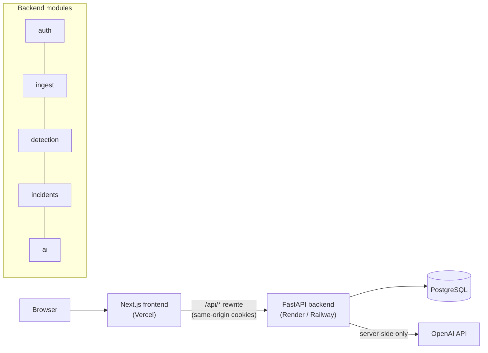
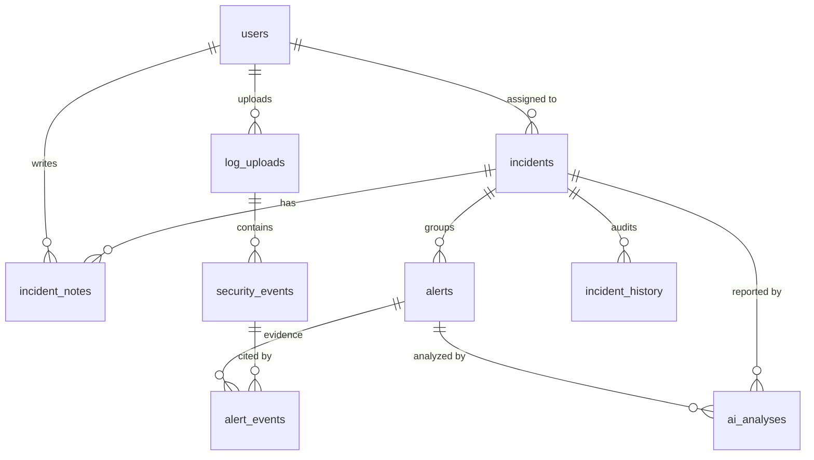

# SentinelAI Architecture

This document is the design contract for SentinelAI. It defines the system shape, data model, API surface, folder layout, and UI map. Code should follow it; when the code needs to diverge, update this file in the same pull request.

## 1. System overview



**Request path.** The browser only ever talks to the Next.js origin. Next.js rewrites `/api/*` to the FastAPI service, so the auth cookie is first-party and never blocked as a third-party cookie. The OpenAI key exists only in the backend's environment.

**Data path.** Upload → validate → parse rows into normalized `security_events` → run detection rules → create `alerts` with linked evidence → analyst promotes alerts to `incidents` → AI analysis is requested on demand and stored separately from verified data.

### Core principle: verified findings vs. AI suggestions

| | Verified findings | AI-generated suggestions |
|---|---|---|
| Produced by | Deterministic detection rules in Python | OpenAI, given the alert's evidence |
| Stored in | `alerts`, `alert_events` | `ai_analyses` |
| Reproducible | Yes — same input, same output | No — labeled with model and prompt version |
| UI treatment | Normal styling, "Verified" badge | Distinct panel, "AI-generated — verify before acting" label |
| Can change incident state | Yes, via analyst action | Never directly |

The AI never decides whether something is malicious. It explains and suggests next steps based on evidence the rules already found.

## 2. Database schema

PostgreSQL with SQLAlchemy 2.0 models and Alembic migrations. All timestamps are `timestamptz` in UTC. Primary keys are UUIDs except `security_events`, which uses `bigint` identity for insert speed and index size.



### Tables

**users**
| column | type | notes |
|---|---|---|
| id | uuid PK | |
| email | citext, unique | login identifier, case-insensitive |
| password_hash | text | Argon2id |
| full_name | text | |
| role | enum `admin`, `analyst`, `viewer` | self-registered users get `viewer`; only admins can promote |
| is_active | bool | admins can deactivate |
| last_login_at | timestamptz null | |
| session_version | int, default 0 | carried in every token; incremented to revoke all sessions |
| created_at, updated_at | timestamptz | |

**log_uploads**
| column | type | notes |
|---|---|---|
| id | uuid PK | |
| original_filename | text | display only, never used as a path |
| format | enum `csv`, `json` | detected from content, not just extension |
| size_bytes | int | |
| sha256 | char(64) | detect duplicate uploads |
| status | enum `processing`, `completed`, `failed` | |
| rows_total, rows_parsed, rows_rejected | int | |
| rejection_samples | jsonb | first 20 rejected rows with reasons |
| uploaded_by | uuid FK users | |
| created_at, completed_at | timestamptz | |

**security_events** — the normalized event store
| column | type | notes |
|---|---|---|
| id | bigint identity PK | |
| upload_id | uuid FK log_uploads, on delete cascade | |
| occurred_at | timestamptz | |
| category | enum `auth`, `network` | |
| action | text | e.g. `login`, `logout`, `connection` |
| outcome | enum `success`, `failure`, `allowed`, `denied` | |
| username | text null | |
| src_ip | inet | |
| dst_ip | inet null | |
| dst_port | int null | 0–65535 check |
| protocol | text null | |
| user_agent | text null | |
| country | char(2) null | ISO code, from the log itself (no live geo lookups) |
| raw | jsonb | original row for audit |

Indexes: `(occurred_at)`, `(src_ip, occurred_at)`, `(username, occurred_at)`, `(upload_id)`.

**alerts** — output of detection rules
| column | type | notes |
|---|---|---|
| id | uuid PK | |
| rule_id | text | e.g. `AUTH-001` |
| title | text | human-readable, generated from a template |
| severity | enum `low`, `medium`, `high`, `critical` | |
| status | enum `open`, `acknowledged`, `dismissed`, `escalated` | |
| src_ip | inet null | |
| username | text null | |
| first_seen, last_seen | timestamptz | |
| event_count | int | |
| details | jsonb | rule-specific facts (counts, distinct users, ports) |
| dedupe_key | text | unique with `rule_id`; prevents duplicate alerts on re-upload |
| upload_id | uuid FK | |
| incident_id | uuid FK null | set when promoted |
| created_at | timestamptz | |

**alert_events** — evidence linkage: `(alert_id, event_id)` composite PK.

**incidents**
| column | type | notes |
|---|---|---|
| id | uuid PK | |
| number | integer identity, unique | shown as a human reference like `INC-0042` (computed, not stored) |
| title, description | text | |
| severity | enum (same as alerts) | |
| status | enum `open`, `investigating`, `contained`, `resolved`, `closed` | |
| assignee_id | uuid FK users null | must be analyst or admin |
| created_by | uuid FK users | |
| created_at, updated_at, closed_at | timestamptz | |

**rate_limit_hits** — `id`, `scope` (e.g. `login_fail_account`), `key` (email or IP), `created_at`; indexed on `(scope, key, created_at)`, pruned after a day.

**incident_notes** — `id`, `incident_id`, `author_id`, `body` (max 10k chars), `created_at`. Notes are append-only.

**incident_history** — audit trail, written by the service layer on every change: `id`, `incident_id`, `actor_id`, `action` (`created`, `updated`, `assigned`, `status_changed`, `note_added`, `alert_linked`), `field`, `old_value`, `new_value`, `created_at`.

**ai_analyses**
| column | type | notes |
|---|---|---|
| id | uuid PK | |
| target_type | enum `alert`, `incident` | |
| target_id | uuid | |
| kind | enum `alert_explanation`, `incident_report` | |
| model | text | exact model name used |
| prompt_version | text | e.g. `alert-v1`; bump when prompts change |
| input_hash | char(64) | SHA-256 of the evidence sent; cache key |
| output | jsonb | validated against a Pydantic schema |
| tokens_in, tokens_out | int | cost tracking |
| requested_by | uuid FK users | |
| created_at | timestamptz | |

Unique `(target_type, target_id, kind, input_hash, prompt_version)` — identical evidence returns the cached analysis instead of calling OpenAI again.

## 3. Log formats

Both formats map to the same canonical fields. Unknown columns are kept in `raw`; missing required fields reject the row, not the file.

| field | required | example |
|---|---|---|
| timestamp | yes | `2026-10-20T03:14:07Z` (ISO 8601) |
| category | yes | `auth` or `network` |
| action | yes | `login` |
| outcome | yes | `failure` |
| src_ip | yes | `203.0.113.45` |
| username | auth only | `jsmith` |
| dst_ip, dst_port, protocol | network only | `10.0.0.5`, `22`, `tcp` |
| user_agent, country | no | `curl/8.4`, `RU` |

- **CSV**: header row required, UTF-8.
- **JSON**: either an array of objects or newline-delimited JSON (one object per line).

All sample data uses documentation IP ranges (`192.0.2.0/24`, `198.51.100.0/24`, `203.0.113.0/24`) and private ranges, plus invented usernames, so nothing resembles a real person or network.

### Upload limits

- Max file size 10 MB, max 100,000 rows (configurable).
- The extension must be `.csv`, `.json`, `.ndjson`, or `.jsonl` and must agree with the content (a `.csv` that contains JSON is refused); binary files are refused.
- An identical file (same SHA-256) can't be uploaded twice.
- Files are read with a hard size cap, parsed, and discarded; only the normalized events (with each original row in `raw`) are kept. Uploaded files are never stored or served back.
- Per-row validation with Pydantic; the upload succeeds if at least one row parses, and reports rejected rows with reasons.

## 4. Detection rules

Each rule is a pure function: `events → list[AlertCandidate]`. Thresholds live in config so tests can tune them.

| ID | Name | Logic (default thresholds) | Severity |
|---|---|---|---|
| AUTH-001 | Brute force | ≥ 5 failed logins for one username from one IP within 10 min | high |
| AUTH-002 | Password spraying | one IP fails against ≥ 5 distinct usernames within 15 min | high |
| AUTH-003 | Success after failures | a successful login preceded by ≥ 3 failures for the same user within 15 min | critical |
| AUTH-004 | Off-hours login | successful login between 00:00–05:00 UTC | low |
| AUTH-005 | New source IP | successful login from an IP not seen for that user earlier in the dataset | medium |
| NET-001 | Port scan | one source hits ≥ 15 distinct ports on one destination within 5 min | high |
| NET-002 | Denied connection burst | ≥ 20 denied connections from one source within 5 min | medium |
| IOC-001 | Known-bad IP | source IP is on the bundled blocklist (synthetic); one alert per IP per UTC day | high |

Window logic uses a sliding window over events sorted by time, grouped by key. That keeps each rule O(n log n) and easy to unit test with hand-built event lists. Overlapping dense windows merge, so one sustained attack produces one alert. Alerts are deduplicated on `(rule_id, dedupe_key)`, so re-uploading overlapping data never duplicates them.

## 5. API

Base path `/api/v1`. JSON in and out. OpenAPI docs served at `/api/docs` (disabled in production unless `ENABLE_DOCS=true`).

### Conventions

- **Auth**: httpOnly, `Secure`, `SameSite=Lax` cookie holding a JWT access token that carries the user's `session_version`; bumping it (logout, password change, deactivation) revokes every existing token. CSRF is mitigated by `SameSite` plus a required `X-Requested-With` header on state-changing requests. Failed logins are rate-limited per account and per client IP (PostgreSQL-backed sliding window). See [SECURITY.md](SECURITY.md).
- **Frontend-only access**: in production the Next.js proxy adds a shared secret and the trusted client IP to every `/api` request, and the API refuses requests without the secret.
- **Pagination**: `?page=1&page_size=25` (max 100). Responses: `{ "items": [...], "page": 1, "page_size": 25, "total": 1340 }`.
- **Filtering**: explicit query params per resource (no free-form query language).
- **Errors**: `{ "error": { "code": "validation_error", "message": "...", "details": [...] } }` with correct status codes (400, 401, 403, 404, 409, 413, 422, 429).

### Routes

| Method | Path | Role | Purpose |
|---|---|---|---|
| GET | `/health` | public | liveness + DB check |
| POST | `/auth/register` | public | create account (role `viewer`) |
| POST | `/auth/login` | public | set auth cookie; rate-limited |
| POST | `/auth/logout` | any | clear cookie |
| GET | `/auth/me` | any | current user |
| PATCH | `/users/me` | any | update name |
| POST | `/users/me/password` | any | change password (requires current) |
| GET | `/users/assignable` | analyst+ | active analysts and admins, for the assignee picker |
| GET | `/users` | admin | list users |
| PATCH | `/users/{id}` | admin | change role / deactivate |
| GET | `/dashboard/summary?range=24h\|7d\|30d` | viewer+ | open alerts by severity, event statistics, alert timeline, top IPs, incident status counts |
| POST | `/uploads` | analyst+ | multipart upload; parses and runs detection |
| GET | `/uploads` | viewer+ | list uploads |
| GET | `/uploads/{id}` | viewer+ | upload detail and rejection samples |
| GET | `/events` | viewer+ | filter: `category, outcome, username, src_ip, upload_id, from, to` |
| GET | `/alerts/rules` | viewer+ | detection rule catalog |
| GET | `/alerts` | viewer+ | filter: `severity, status, rule_id, src_ip, q, upload_id, incident_id, from, to` |
| GET | `/alerts/{id}` | viewer+ | alert + evidence events + latest AI analysis |
| PATCH | `/alerts/{id}` | analyst+ | change status |
| POST | `/alerts/{id}/promote` | analyst+ | create incident from alert(s) |
| GET | `/incidents` | viewer+ | filter: `status, severity, assignee_id, q` |
| POST | `/incidents` | analyst+ | create |
| GET | `/incidents/{id}` | viewer+ | detail with alerts, notes |
| PATCH | `/incidents/{id}` | analyst+ | title, description, severity, status, assignee |
| POST | `/incidents/{id}/notes` | analyst+ | add note |
| GET | `/incidents/{id}/history` | viewer+ | audit trail |
| POST | `/ai/alerts/{id}/explain` | analyst+ | explanation + investigation steps (cached) |
| POST | `/ai/incidents/{id}/report` | analyst+ | structured incident report (cached) |
| GET | `/ai/incidents/{id}/report` | viewer+ | latest stored report, if any |
| GET | `/ai/status` | viewer+ | whether AI is configured, and the model name (never the key) |

### Role matrix

| Capability | viewer | analyst | admin |
|---|:-:|:-:|:-:|
| View dashboard, events, alerts, incidents | ✓ | ✓ | ✓ |
| Upload logs, change alert status | | ✓ | ✓ |
| Create / edit / assign incidents, add notes | | ✓ | ✓ |
| Request AI analysis | | ✓ | ✓ |
| Manage users and roles | | | ✓ |

Authorization is enforced in the backend with a `require_role(...)` dependency on each route. The frontend hides controls by role only for usability; it is never the security boundary.

### AI output schema

```json
{
  "summary": "string, 2-4 sentences",
  "explanation": "plain-English description of what the evidence shows",
  "likely_tactics": ["e.g. credential stuffing"],
  "investigation_steps": [{ "step": "string", "rationale": "string" }],
  "recommended_severity": "low | medium | high | critical",
  "confidence": "low | medium | high",
  "caveats": ["what the evidence does not establish"]
}
```

The model is called with structured output against this schema and the result is re-validated with Pydantic before storage. The prompt includes only the alert's facts and up to 50 evidence events, never other users' data or secrets. Rate limit: 20 new AI requests per user per hour (cached results don't count).

Log fields are attacker-controlled, so they reach the model only inside one `<data>` block in which `<` and `>` are escaped; a log value can't close the block and pose as instructions. Incident-report indicators that don't appear verbatim in the input data are removed, and the count of removed items is shown to the analyst.

## 6. Folder structure

```
sentinelai/
├── backend/
│   ├── app/
│   │   ├── main.py              # FastAPI app factory, middleware, routers
│   │   ├── core/                # config (pydantic-settings), security, errors, logging
│   │   ├── db/                  # engine, session, base model
│   │   ├── models/              # SQLAlchemy models, one file per aggregate
│   │   ├── schemas/             # Pydantic request/response models
│   │   ├── api/
│   │   │   ├── deps.py          # get_db, get_current_user, require_role
│   │   │   └── v1/              # one router per resource
│   │   ├── services/            # business logic (incidents, uploads, dashboard)
│   │   ├── ingest/              # csv/json parsers, row normalization
│   │   ├── detection/           # rules/*.py, engine.py, blocklist data
│   │   └── ai/                  # client wrapper, prompts, output schemas
│   ├── alembic/                 # migrations
│   ├── tests/                   # pytest: unit (rules, parsers) + API (httpx)
│   ├── scripts/                 # seed.py (demo users, incidents, synthetic upload), generate_sample.py
│   ├── pyproject.toml
│   └── Dockerfile
├── frontend/
│   ├── src/
│   │   ├── app/
│   │   │   ├── (auth)/login, register
│   │   │   └── (app)/dashboard, alerts, incidents, events, uploads, settings, admin/users
│   │   ├── components/          # ui/ (shadcn), layout/, charts/, tables/, forms/
│   │   ├── lib/                 # api client, auth helpers, formatters
│   │   └── hooks/               # TanStack Query hooks per resource
│   ├── e2e/                     # Playwright end-to-end tests
│   ├── next.config.ts           # /api rewrite to backend
│   └── Dockerfile
├── sample-data/                 # synthetic CSV/NDJSON logs (generated by backend/scripts)
├── docs/                        # this file, API notes, screenshots
├── .github/workflows/           # ci.yml (lint, tests, e2e, Docker smoke test), codeql.yml
├── docker-compose.yml           # postgres + backend + frontend
└── .env.example
```

**Layering rule (backend):** routers handle HTTP only → services hold business logic → models/DB. Detection and ingest modules are pure Python with no FastAPI or DB imports, which is why they are fast and simple to unit test.

## 7. UI map

Dark theme by default, built with shadcn/ui components, Recharts for charts, TanStack Query for data fetching and caching.

| Route | Content |
|---|---|
| `/login`, `/register` | Centered card forms with inline validation |
| `/dashboard` | KPI cards (events, open alerts, open incidents, critical alerts) · alerts-over-time line chart · severity donut · top source IPs table · recent alerts list · time-range selector |
| `/alerts` | Filterable, paginated table (severity, status, rule, IP, search) · row click → detail |
| `/alerts/[id]` | Verified facts panel · evidence events table · AI analysis panel (clearly labeled, "Generate" button) · status actions · "Promote to incident" |
| `/incidents` | Table with status and severity filters, assignee, "New incident" modal |
| `/incidents/[id]` | Header with status/severity/assignee controls · linked alerts · notes thread · history timeline · "Generate AI report" |
| `/events` | Raw normalized events with filters (power-user view) |
| `/uploads` | Drag-and-drop upload card · upload history with parsed/rejected counts |
| `/settings` | Profile and password change |
| `/admin/users` | User list with role and active toggles (admin only) |

**Layout:** collapsible sidebar on desktop, sheet-style drawer on mobile, top bar with user menu. Every data view has loading skeletons, empty states, and error states; mutations show toast notifications.

## 8. Build order (MVP first)

1. Backend skeleton, config, DB, `/health`, Alembic baseline, docker-compose.
2. Ingest + detection as pure modules with unit tests and sample data.
3. Models, migrations, upload endpoint, events/alerts endpoints.
4. Frontend shell (layout, sidebar, theme) + uploads, alerts, dashboard pages.
5. Incidents with notes and history.
6. AI analysis endpoints and panels.
7. Auth, roles, rate limits, security headers; then tests and CI.
8. Deploy, seed demo data, README, screenshots.

Auth is listed in Phase 5 of the plan, but the user model and `get_current_user` dependency are stubbed from step 1 so routes are written with authorization in mind from the start.
