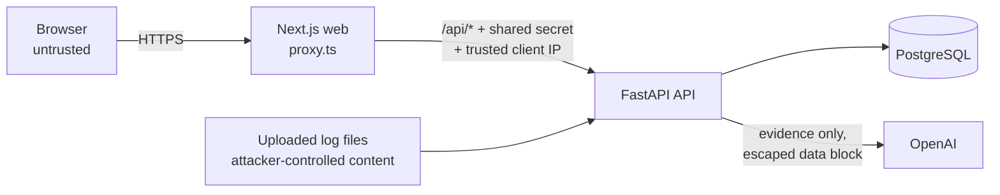

# SentinelAI security design

This document lists the threats SentinelAI is designed against, the control for each, where it lives in the code, and the test that proves it works. It ends with known limitations, because a security design is only credible if it says what it doesn't cover.

## Trust boundaries

Three inputs are treated as hostile:

1. **Anything from the browser**: headers, cookies, form fields, query strings.
2. **Uploaded log content**: usernames, user agents, and other fields are written by whoever generated the traffic, which in a real SOC includes attackers.
3. **Model output**: it's useful, but it's never allowed to change data or appear as a verified finding.

## Threats and controls

### Authentication and sessions

| Threat | Control | Code | Proven by |
|---|---|---|---|
| Password database leak | Argon2id hashing (memory-hard), never stored or logged in plain text | `core/security.py` | `test_auth.py` |
| Session theft through XSS | Session JWT lives in an `httpOnly` cookie that JavaScript can't read; `Secure` in production | `api/v1/auth.py` | `test_register_creates_viewer_and_sets_httponly_cookie` |
| Brute-force password guessing | 5 failures per account in 15 minutes locks sign-in; the lock is checked *before* the password, so even the right password is refused during it. Each attempt is counted atomically before the password is checked (a short PostgreSQL advisory lock, released before the slow hash), so simultaneous guesses can't slip past the limit | `services/rate_limit.py`, `api/v1/auth.py` | `test_account_locks_after_five_failures_even_for_the_right_password`, `test_simultaneous_guesses_cannot_exceed_the_account_limit`; e2e lockout test |
| Password spraying (one IP, many accounts) | 20 failures per client IP in 15 minutes, when the web app forwards a trusted client IP. Without one, per-IP limits are off rather than applied to the web server's own address, which would let one attacker lock every visitor out | same, `core/proxy_auth.py` | `test_one_ip_spraying_many_accounts_is_blocked`, `test_without_a_forwarded_client_ip_one_attacker_cannot_lock_out_everyone` |
| Guessing the current password with a stolen session | Password change allows 5 wrong current-password attempts per account in 15 minutes, counted the same way as sign-in | `api/v1/users.py` | `test_current_password_guesses_on_password_change_are_limited` |
| Account enumeration | Identical error and timing for wrong password and unknown email (a dummy hash is verified when the user doesn't exist); unknown emails lock out exactly like real ones | `core/security.py`, `api/v1/auth.py` | `test_login_wrong_password_and_unknown_user_give_same_error`, `test_unknown_emails_lock_the_same_way_so_lockout_reveals_nothing` |
| A stolen or copied cookie stays valid after logout | Each token carries the user's `session_version`; logout, password change, and deactivation bump it, so every existing token is rejected immediately | `api/deps.py` | `test_logout_revokes_a_copied_token`; e2e cookie-replay test |
| Forged tokens (`alg: none`, wrong key) | Signature verified with a pinned algorithm; required claims enforced | `core/security.py` | `test_forged_algorithm_none_token_is_rejected`, `test_tampered_cookie_is_rejected` |
| Weak or placeholder secrets reach production | Startup refuses placeholder `JWT_SECRET` or a missing or short `PROXY_SHARED_SECRET` in production | `core/config.py` | `test_production_refuses_placeholder_secrets`, `test_production_requires_a_strong_proxy_secret` |

### Authorization

| Threat | Control | Code | Proven by |
|---|---|---|---|
| Privilege escalation | Self-registration always creates a read-only viewer; only admins grant roles; admins can't demote themselves (no lockout of the last admin) | `api/v1/auth.py`, `api/v1/users.py` | `test_admin_can_promote_user_but_not_demote_self`; e2e "new accounts start with read-only access" |
| Stale privileges | The user and role are reloaded from the database on every request, never trusted from the token | `api/deps.py` | `test_deactivation_takes_effect_immediately` |
| Hidden buttons treated as security | Every protected route declares its minimum role on the server (`Viewer`/`Analyst`/`Admin`); the UI hides controls only for convenience | `api/deps.py`, every router | `test_viewer_can_read_but_not_write`; e2e role tests, which call the API directly |

### Web and API

| Threat | Control | Code | Proven by |
|---|---|---|---|
| Cross-site request forgery | `SameSite=Lax` cookie, plus a required `X-Requested-With` header on every state-changing request (a cross-site form or fetch can't add it without a CORS preflight, which is refused) | `core/csrf.py` | `test_state_changing_requests_need_the_csrf_header`; e2e CSRF test |
| Bypassing the web app to hit the API directly, or forging a client IP | The Next.js proxy strips client copies of internal headers and attaches a shared secret plus the client IP from trusted infrastructure; the API refuses requests without the secret (health check excepted) and only then trusts the IP | `frontend/src/proxy.ts`, `core/proxy_auth.py` | `test_direct_calls_are_refused_once_a_secret_is_configured`, `test_per_ip_limit_uses_the_client_ip_forwarded_by_the_frontend`; e2e direct-API test |
| Open redirect after sign-in | The `?next=` target is resolved as a URL and must stay on this origin (blocks `//evil.com` and `/\evil.com`) | `frontend/src/lib/redirect.ts` | e2e "a crafted next= link can't redirect off-site" |
| XSS | React escapes all output and the app never renders raw HTML; CSP blocks scripts, styles, and connections to other origins, framing, `<object>`, `<base>`, and off-site form posts | `frontend/next.config.ts` | e2e CSP test (fails on any CSP violation in the console) |
| Clickjacking | `frame-ancestors 'none'` and `X-Frame-Options: DENY` on the web app and the API | `next.config.ts`, `core/headers.py` | `test_security_headers_on_success_error_and_csrf_responses` |
| Sensitive responses cached by browsers or proxies | `Cache-Control: no-store` on every API response | `core/headers.py` | same |
| SQL injection | ORM with bound parameters only; search input is LIKE-escaped so `%` and `_` match literally | `services/*.py` | `test_list_filters_search_and_pagination` (wildcard case) |

### File uploads

| Threat | Control | Code | Proven by |
|---|---|---|---|
| Malicious or oversized files | Extension allow-list, the extension must agree with the content, binary rejected, hard size cap enforced while streaming, row cap; the web proxy refuses bodies over 11 MB before buffering them, so over-limit uploads get a clear 413 rather than a truncated request | `ingest/parser.py`, `api/v1/uploads.py`, `frontend/src/proxy.ts` | `test_unsafe_or_mismatched_files_are_refused`, `test_oversized_upload_rejected`; e2e oversized-upload test |
| Path traversal through filenames | The filename is display-only and never used as a path; files are never written to disk | `services/uploads.py` | `test_path_in_filename_is_ignored` |
| A bad row poisoning the dataset | Every row is validated (IP formats, port ranges, category rules); bad rows are rejected with a reason, and the import is all-or-nothing in one transaction | `ingest/schema.py`, `services/uploads.py` | `test_bad_rows_are_rejected_with_reasons_not_fatal`, `test_failure_mid_pipeline_leaves_no_partial_data` |

### AI

| Threat | Control | Code | Proven by |
|---|---|---|---|
| Prompt injection through log content | Log data reaches the model only inside one `<data>` block in which `<` and `>` are escaped, so a field like `</data>IGNORE...` can't break out; the instructions treat the block as untrusted data | `ai/prompts.py` | `test_log_content_cannot_break_out_of_the_data_block` |
| Hallucinated indicators | Indicators in incident reports must appear verbatim in the input data; others are removed and the count is shown to the analyst | `services/ai.py` | `test_incident_report_drops_hallucinated_indicators`; e2e investigation test |
| AI output mistaken for fact | Stored separately (`ai_analyses`), labeled "AI-generated" with model, prompt version, and requester; it can't change alert or incident state | `models/security.py`, `components/ai-panel.tsx` | `test_explain_alert_stores_labeled_result_and_caches` |
| Key exposure or runaway cost | The key lives only on the backend (never `NEXT_PUBLIC_`) and is never returned by the API; 20 new requests per user per hour, plus a site-wide daily budget counted atomically before each call, so creating many accounts can't overspend; identical evidence is served from cache; OpenAI data retention is off (`store=False`) | `ai/client.py`, `ai/provider.py`, `services/ai.py` | `test_rate_limit_applies_to_new_calls`, `test_site_wide_daily_budget_caps_new_calls_across_all_users`, `test_provider_setting_selects_the_client_and_ai_is_off_without_a_key`, `test_structured_output_round_trip` |
| Malformed model output | Structured output against a strict schema, re-validated with Pydantic before storage | `ai/client.py` | `test_schema_violation_is_reported_not_stored` |

### Supply chain and process

- **CI** runs lint, migration drift checks, 164 backend tests with a 90% coverage floor, 19 browser tests, and a Docker Compose smoke test on every push.
- **CodeQL** scans Python and TypeScript on every push and weekly.
- **Dependabot** opens weekly update PRs for pip, npm, GitHub Actions, and base images.
- **Secrets** are kept out of the repository; `.env` is git-ignored, and the full history was scanned during the Phase 1–4 audit.

## Known limitations

These are deliberate scope choices, not oversights:

- **The CSP allows inline scripts.** Nonce-based CSP would require rendering every page per request, which is incompatible with the prerendered static shell (Next.js Cache Components). XSS defense rests on React's escaping and on never rendering raw HTML; the CSP still blocks external scripts and data exfiltration to other origins.
- **Logout ends all of a user's sessions,** not just the current one. A per-session table would allow "sign out this device only", at the cost of more state.
- **Registration still says when an email is taken.** It's rate-limited per IP; fully preventing this needs email verification, which is out of scope for a demo with no mail service.
- **Account lockout can be used to annoy a user** by failing logins on their email. That's the standard tradeoff for lockouts; the lock is short (15 minutes) and IP limits slow the attacker.
- **The per-IP limits need a trusted client-IP source.** They're only as accurate as the header named in `CLIENT_IP_HEADER` on the web server (set per hosting provider). Without it they're switched off (the API logs a warning once), and the per-account lock still protects every account.
- **Synthetic threat intelligence.** The known-bad IP list is a fixed demo list, not a live feed.
- **No MFA.** It would be the next addition for a production deployment.
