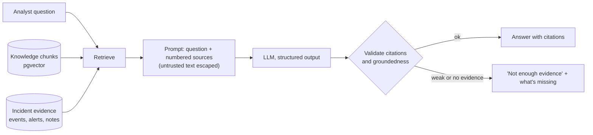

# SentinelAI v2 design

v2 turns SentinelAI from "detect and triage" into a full investigation workspace: a retrieval-augmented (RAG) security assistant with citations, MITRE ATT&CK mapping, Windows, process and DNS telemetry, analyst review of AI findings, PDF incident reports, and an evaluation dashboard that measures the AI instead of trusting it.

This document is the plan for building it. [ARCHITECTURE.md](ARCHITECTURE.md) describes v1 as built; the two are merged when v2 ships.

## Decisions

| Decision | Choice | Why |
|---|---|---|
| Extend or rebuild | Extend v1 | Auth, ingestion, detection, incidents, CI and deployment are built and tested. v2 adds to them. |
| LLM provider | Configurable: **Gemini** (default for the demo) or **OpenAI** | Gemini's free tier covers chat and embeddings at $0. Both are called through the OpenAI-compatible API, so one client serves both and switching is one setting. |
| Vector store | **pgvector** in the existing PostgreSQL | One database to run, back up and secure. Chunks, citations and permissions live in normal tables next to the data they describe, and the volume is thousands of chunks, not millions. Neon supports it. |
| Embedding size | 768 dimensions | Gemini's embedding model can shorten its output; 768 keeps the HNSW index small and well under pgvector's 2,000-dimension index limit. |
| Background jobs | PostgreSQL job table, worker thread in the API process, `SELECT … FOR UPDATE SKIP LOCKED` | Long AI jobs (reports, evaluation runs, document embedding) need to outlive a request, but the free hosts have no Redis or separate worker. Jobs survive restarts and the API's sleep on the free plan. Easy to move to a separate worker later. |
| Auth | Keep v1's (Argon2id, httpOnly sessions, lockout, revocation) | Hardened and tested; replacing it adds risk and no capability. |
| Hosting | Vercel + Render + Neon (free) for the live demo; **AWS deployment guide** with infrastructure code | The demo stays at $0; the guide shows how it maps to AWS (ECS Fargate, RDS for PostgreSQL with pgvector, Secrets Manager, CloudWatch). |
| PDF reports | Server-side HTML → PDF with WeasyPrint | One template for the screen and the PDF. The PDF is built from stored, reviewed data, so it matches what the analyst approved. |
| MITRE ATT&CK | Official Enterprise ATT&CK STIX data (MITRE's `attack-stix-data` repo), trimmed to techniques and tactics and bundled with a pinned version | Mappings can only use real IDs. Anything the model suggests outside the dataset is rejected. |

## What's new, by feature

### A. Dashboard
v1's dashboard plus investigations in progress, incident response status, and recent suspicious activity across the new event types.

### B. Log analyzer: new telemetry
New event categories `windows`, `process` and `dns`, with fields `event_code`, `host`, `process_name`, `parent_process`, `command_line`, `service_name`, `query_name`, `query_type`.

| Rule | Detects | ATT&CK (fixed, verified) | Severity |
|---|---|---|---|
| WIN-001 | Brute force from Windows logons (4625 bursts) | T1110.001 | high |
| WIN-002 | Successful logon (4624) after 4625 failures | T1110, T1078 | critical |
| WIN-003 | Suspicious process (4688): encoded PowerShell, Office spawning a shell, known LOLBins | T1059.001, T1218 | high |
| WIN-004 | New service installed (7045), especially from temp or user paths | T1543.003 | high |
| DNS-001 | Possible DNS tunneling: long or high-entropy subdomains to one domain | T1071.004 | medium |
| DNS-002 | Algorithmically generated (DGA-like) domains that fail to resolve | T1568.002 | medium |
| NET-003 | Beaconing: connections to one destination at regular intervals | T1071 | high |

Existing rules get fixed ATT&CK mappings too. Each rule→technique mapping is part of the rule's code and its tests, so it's a verified finding, not AI output.

### C. RAG security assistant

- **Knowledge base**: documents admins upload (Markdown, text, PDF), plus bundled content: ATT&CK technique descriptions and original runbooks written for this project (brute force, phishing, malware on a host, DNS tunneling, privilege escalation). Documents are split into ~800-token chunks with overlap and headings kept, embedded, and stored with their source and position.
- **Retrieval**: cosine similarity over an HNSW index, combined with PostgreSQL full-text search (hybrid search), so exact terms like `T1059.001` or `4625` aren't missed by embeddings. Top chunks above a similarity threshold go into the prompt.
- **Scope**: a question asked from an investigation also gets that incident's alerts, evidence events and notes as sources. Users only retrieve evidence they're allowed to see.
- **Citations**: every source in the prompt has an ID (`[K3]` for a knowledge chunk, `[E812]` for an event). The answer must cite them, the server checks that each cited ID was actually provided, and answers with uncited claims or invalid citations are flagged.
- **Insufficient evidence**: if retrieval finds nothing above the threshold, or the model reports low support, the assistant says so and lists what evidence would help, instead of guessing.
- **Prompt injection**: knowledge documents and log fields are untrusted. They're escaped inside data blocks (as in v1), the system prompt states that instructions inside sources must be ignored, and a test suite of injection attempts (in logs, in uploaded documents, in questions) checks that none of them change the assistant's behavior or leak the system prompt.
- **Conversations** are stored per user and per investigation, with each answer's sources, model, tokens and latency.

### D. Investigation workspace
v1's incident page becomes an investigation workspace: an event timeline across all linked alerts, the assistant in a side panel, and **AI findings that need review**. The AI proposes findings (a conclusion, ATT&CK techniques, a severity); an analyst accepts, rejects or edits each one. Only accepted findings become official, and every decision is recorded in the history with who made it.

### E. MITRE ATT&CK mapping
A technique view per investigation: technique ID and name, tactic, the evidence behind it, the rationale, and a confidence indicator. Two kinds, labeled differently:
- **Verified**: from detection rules (fixed mappings, tested).
- **AI-suggested**: from the model, accepted only if the ID exists in the bundled dataset; shown as suggestions until an analyst accepts them.

### F. Incident reports and PDF export
A report is generated from the investigation's accepted findings, timeline, evidence, ATT&CK techniques, analyst conclusions and remediation steps. Verified evidence and AI interpretation are in visually separate sections. Reports are versioned; the PDF is rendered from a stored version, so it always matches what was reviewed.

### G. AI evaluation dashboard
A versioned evaluation set (`backend/evals/`) of questions about the synthetic data and knowledge base, each with the sources a correct answer should cite and the facts it must contain.

| Metric | How it's measured |
|---|---|
| Retrieval relevance | recall@k and mean reciprocal rank of the expected sources |
| Citation correctness | share of citations that point to sources that were provided and that support the claim |
| Groundedness | share of required facts present, and of answer claims supported by the cited sources (model-graded, with the grader's prompt versioned) |
| Latency | p50 / p95 per stage: retrieval, generation, total |
| Tokens and cost | tokens per answer; estimated cost at the provider's list price (the demo itself pays $0) |
| Pass rate | questions meeting all thresholds |

`python -m scripts.run_evals` runs the set and stores the results; the dashboard charts them across runs, so a prompt or model change shows its effect. CI runs the retrieval and citation checks with deterministic test embeddings; full runs against the real model run on demand from GitHub Actions with the API key stored as a repository secret.

## Cross-cutting

- **Audit log**: an append-only `audit_logs` table for security-relevant actions: sign-ins, role changes, uploads, document ingestion, AI requests, report exports, and finding reviews. Actor, action, target, IP and time. Admins can view it.
- **Redaction before AI**: before any text goes to the model, the server masks secrets and personal data (passwords and tokens in command lines, API keys, email addresses, card and Social Security numbers) and reports how many items were masked. IPs and usernames stay, since they're the evidence and the demo data is synthetic. Covered by tests.
- **AI cost and abuse limits**: the existing per-user hourly limit, plus a site-wide daily budget so the public demo stays inside the free tier, plus caching of identical requests.
- **Monitoring**: structured JSON logs with request IDs, a deeper health check (database, pgvector, AI provider reachable), job queue status, and AI usage on the evaluation dashboard.
- **Light and dark themes**, with dark navy as the default.
- **Navigation** (as in the brief): Overview · Security Events · Alerts · Investigations · AI Assistant · Knowledge Base · AI Evaluations · Reports · Settings.

## New tables

| Table | Purpose |
|---|---|
| `knowledge_documents` | title, source type (bundled / uploaded), content hash, status, uploader |
| `document_chunks` | document, position, heading, text, token count, `embedding vector(768)` with an HNSW index, full-text `tsvector` with a GIN index |
| `attack_techniques` | bundled ATT&CK techniques and tactics with the dataset version |
| `alert_techniques` | rule-based technique mappings per alert (verified) |
| `ai_findings` | proposed conclusions, techniques and severities per investigation, with review status, reviewer and edits |
| `assistant_conversations`, `assistant_messages` | questions, answers, cited sources, model, tokens, latency |
| `incident_reports` | versioned reports and their content; the PDF is rendered from these |
| `jobs` | background work: type, payload, status, attempts, errors, timing |
| `eval_runs`, `eval_results` | evaluation runs and per-question scores |
| `audit_logs` | security-relevant actions |

`security_events` gains the new telemetry columns, and `ai_analyses` gains `provider` and `latency_ms`.

## Build phases

| Phase | Delivers |
|---|---|
| 1 | This design; pgvector in every environment; the provider switch (Gemini or OpenAI) for chat and embeddings; a site-wide AI budget |
| 2 | Audit log, light/dark themes, new navigation, background job queue, deeper health check |
| 3 | Windows, process and DNS ingestion; the 7 new rules with ATT&CK mappings; updated synthetic data |
| 4 | Knowledge base ingestion (chunking, embeddings, hybrid search), the RAG assistant with validated citations, prompt-injection test suite, redaction |
| 5 | Investigation workspace with reviewed AI findings, ATT&CK view, versioned reports, PDF export |
| 6 | Evaluation set, runner and dashboard; security review; deployment updates; AWS guide |
| 7 | Documentation, screenshots, resume bullets, interview walkthrough, demo script |

Each phase ends with its tests passing in CI and the live demo updated.
